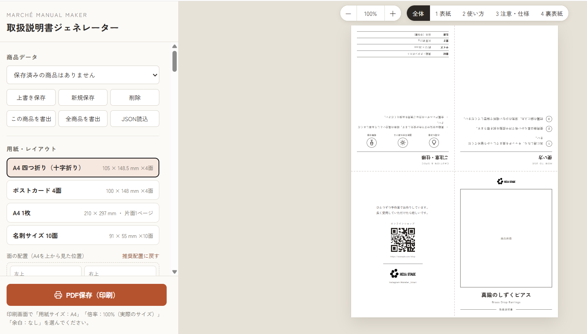

# Marché Manual Maker

マルシェやハンドメイドイベントに出店する方のための「取扱説明書ジェネレーター」です。
商品名・使い方・注意事項などを入力するだけで、作品に添える小さな取扱説明書をデザインできます。
ブラウザだけで動き、インストールや会員登録は不要です。完成した説明書はブラウザの印刷機能から、A4用紙への印刷やPDF保存ができます（文字や線がにじまない、くっきりした仕上がりです）。

## 使い方

### 1. ツールを開く
- **Webで使う**: https://tsuchicco0113-png.github.io/March-Manual-Maker/ を開くだけで使えます。
- **ダウンロードして使う**: このページの「Code → Download ZIP」でダウンロードし、**zipを展開してから** `index.html` をブラウザ（Chrome / Edge 推奨）で開いてください。
  - `index.html` と `assets` フォルダは同じ場所に置いたままにしてください。
  - zipの中から直接開くと、正しく表示されないことがあります。
- どちらの場合もインターネット接続が必要です（画面の部品・QRコード・フォントをネットから読み込みます）。

### 2. 用紙・レイアウトを選ぶ
左側の「用紙・レイアウト」から、作りたい形を選びます。

| レイアウト | 仕上がりサイズ | こんなときに |
|---|---|---|
| A4 四つ折り（十字折り） | 105 × 148.5 mm × 4面 | A4を折って、表紙・使い方・注意・裏表紙の冊子風に |
| ポストカード 4面 | 100 × 148 mm × 4面 | はがきサイズのカードとして同梱 |
| A4 1枚 | 210 × 297 mm | 1枚にまとめた説明書。ブロックを自由に並べ替え可能 |
| 名刺サイズ 10面 | 91 × 55 mm × 10面 | 小さな作品に添えるミニカード |

A4四つ折りでは「面の配置」で各面の位置を入れ替えたり、「天地反転 180°」で上下を逆にしたりできます。迷ったら「推奨配置に戻す」を押してください。

### 3. 内容を入力する
左側の各項目を上から順に入力します。入力した内容は右側のプレビューにすぐ反映されます。

1. **表紙** — ブランド名・商品名・サブタイトル・商品画像。必要なら価格・品番（SKU）・カラーや素材のバリエーションも印字できます。
2. **使い方** — 手順を1行に1ステップずつ入力します。手順ごとに画像を付けることもできます。
3. **注意事項・仕様** — 注意書きを1行に1項目ずつ入力し、注意マーク（ピクトグラム）を追加します。仕様は「項目：内容」の形で1行ずつ書きます（例：`素材：真鍮`）。
4. **裏表紙・ブランド情報** — お礼のメッセージ、ショップやSNSのQRコード（2つまで）、SNS・連絡先を入れます。

> 文字が枠からはみ出すと、画面左上に赤い警告が出ます。文章を短くするか、「スタイル・余白」で文字サイズを小さくしてください。

### 4. 見た目を整える（お好みで）
- **スタイル・余白** — フォント、文字サイズ、罫線・枠のスタイル、余白の調整
- **アナログ風の質感** — 手描き風のゆらぎ、紙の質感、インクのかすれ・にじみ
- **写真のあしらい** — 写真の傾き、マスキングテープ、キャプション
- **スタンプ** — 「Thank you」「Handmade」などのスタンプを押せます
- **デコレーション** — 好きな画像を自由な位置に配置（移動・拡大・回転）
- **ロゴ** — 自分のロゴ画像に差し替えられます

右上の「−／＋」で拡大縮小、「全体／1 表紙／2 使い方…」で表示する面を切り替えられます。

### 5. 保存しておく
「商品データ」の **新規保存** で、今の内容をブラウザに保存します。
商品ごとに保存しておけば、次回はリストから選ぶだけで呼び出せます。内容を直したときは **上書き保存** を押してください。

### 6. 印刷・PDF保存する
1. 左下の **「PDF保存（印刷）」** を押します。
2. 印刷画面で次のように設定します。
   - 用紙サイズ：**A4**
   - 倍率：**100%（実際のサイズ）**
   - 余白：**なし**
3. プリンターで印刷するか、送信先で「PDFに保存」を選びます。

> 倍率や余白が違うと、折り位置や面の位置がずれます。必ず上の設定にしてください。

### 7. 折る（A4 四つ折りの場合）
印刷したA4を、**上半分 → 左半分の順に「山折り（うしろへ）」** で折ると完成です。
右側のプレビューは、この順で折ったときの見え方になっています。折り目の点線ガイドは「表示ガイド」で印刷のON/OFFを切り替えられます。

### 両面印刷するとき
「両面印刷（裏面を2ページ目に出力）」をONにすると、裏面にロゴの総柄やサンクスメッセージを入れられます。
両面対応のプリンターで **「長辺とじ」** を選んで印刷してください。

### 印刷がずれるとき
プリンターによっては、印刷位置が少しずれることがあります。
「印刷ズレ補正」で左右（X）・上下（Y）の位置をmm単位で調整してください。裏面は給紙のしかたでずれ方が変わるため、「裏面のズレ補正」で別に調整できます。

## 主な機能
- レイアウト：A4四つ折り（十字折り）／A4 1枚（ブロック自由配置）／名刺10面／ポストカード4面
- 面ごとの天地反転、拡大縮小
- 商品画像（位置・拡大・フチなし印刷）、QRコード×2、注意ピクトグラム、ロゴ
- 自由配置のデコ画像（移動・拡大・回転、配置した面に追従）
- 両面印刷（ロゴ総柄／サンクスメッセージ）、印刷ズレ補正
- 手描き風のゆらぎ・かすれ・にじみ、紙の質感、マスキングテープ風、スタンプ
- 複数商品の保存、JSONでの書き出し・読み込み、リンク集ページ（HTML）の書き出し

## データの保存とバックアップ
入力内容は、お使いのブラウザの中（localStorage）にだけ保存されます。サーバーには送信されません。
そのため、ブラウザのデータを消したり別のパソコンで開いたりすると、保存した内容は表示されません。

- **バックアップ**：「この商品を書出」または「全商品を書出」で、JSONファイルとして保存できます。
- **復元・引っ越し**：「JSON読込」で、書き出したファイルを読み込めます。

## 自分のGitHub Pagesで公開する場合
このリポジトリをフォークし、Settings → Pages → Branch を `main` / `(root)` にして保存してください。
